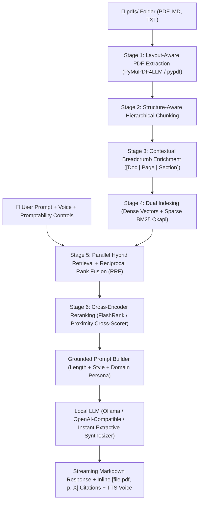

# Pure RAG 🧠📄

<div align="center">

**The Universal, State-of-the-Art Local RAG Pipeline & AI Chatbot**  
*Drop your PDFs in `pdfs/` • Run one command • Chat with your documents locally via Text & Voice*

[](LICENSE)
[](https://github.com/callmesobhan/Pure-RAG)
[](pyproject.toml)
[](AGENTS.md)

</div>

---

## ✨ Why Pure RAG?

**Pure RAG** is built for **anyone in any field**—medicine, law, academic research, software engineering, finance, or education—who wants a **private, local, state-of-the-art Retrieval-Augmented Generation (RAG) app** without writing glue code or configuring vector databases.

1. **📂 Drop-Folder Simplicity**: Put your PDFs (`.pdf`), Markdown (`.md`), or text (`.txt`) files in the designated `pdfs/` folder (or drag-and-drop them right into the web app).
2. **🔬 Researched SOTA Retrieval Pipeline**: Goes far beyond "naive RAG" by combining **Layout-Aware PDF Parsing**, **Contextual Breadcrumb Chunking**, **Parallel Hybrid Search (Dense Embeddings + BM25 Okapi)**, **Reciprocal Rank Fusion (RRF)**, and **Second-Stage Cross-Encoder Reranking**.
3. **🎛️ Full Promptability**: Control every answer with one click right above the prompt box—get **Shorter**, **Balanced**, or **Longer** answers in **Standard**, **Precise**, **Bulleted**, **Executive Brief**, **Step-by-Step**, **Simple (ELI5)**, or **Strict Citations Only** format, plus custom **Domain Personas**.
4. **🎙️ Voice-to-Speech & Read-Aloud**: Dictate questions with your microphone (Speech-to-Text) and listen to grounded answers aloud (Text-to-Speech).
5. **🖥️ Permissioned Hardware Analyzer**: Automatically inspects your OS, CPU, RAM, Disk, and GPU (Apple Silicon Metal, NVIDIA CUDA, AMD ROCm, or CPU) to recommend the best model tier—and **always asks permission** before downloading models.
6. **🤖 Built for Both Humans & AI Agents**: One-command interactive installers for humans (`./install.sh`, `.\install.ps1`) and deterministic non-interactive CLI/JSON modes (`--yes`, `--json`) for AI agents (see [`AGENTS.md`](AGENTS.md)).

---

## 🚀 Quick Start (macOS, Linux & Windows)

### 🍎 macOS & 🐧 Linux
```bash
git clone https://github.com/callmesobhan/Pure-RAG.git
cd Pure-RAG
bash ./run.sh
```
*(On first run, `run.sh` analyzes your hardware, asks permission to set up your environment, indexes the `pdfs/` folder, and opens `http://127.0.0.1:8000` in your browser!)*

### 🪟 Windows (Command Prompt or PowerShell)
```bat
git clone https://github.com/callmesobhan/Pure-RAG.git
cd Pure-RAG
.\run.bat
```
*(Or in PowerShell: `powershell -ExecutionPolicy Bypass -File .\install.ps1 -Serve`)*

### 🤖 For AI Agents (Zero-Prompt Automated Install)
```bash
git clone https://github.com/callmesobhan/Pure-RAG.git
cd Pure-RAG
bash ./install.sh --yes
./.venv/bin/purerag query "Summarize the documents in bullet points" --length shorter --style bulleted --format json
```
Read [`AGENTS.md`](AGENTS.md) for the complete AI-agent specification.

---

## 🏗️ SOTA 6-Stage RAG Architecture

Naive RAG systems split PDFs into arbitrary character windows and run pure vector search, which breaks tables, loses section context, and fails on exact keywords (acronyms, part numbers, legal clauses, dosages).

**Pure RAG** implements a 6-stage high-precision retrieval pipeline:



### Mathematical Formulation of Hybrid RRF + Reranking
1. **Contextual Enrichment**: Every chunk $c_i$ is enriched with its document ancestry before indexing:
   $$\tilde{c}_i = \text{concat}\big(\text{"[Document: } D \text{ | Page } p \text{ | Section: } H_1 > H_2\text{]\n"}, c_i\big)$$
2. **Reciprocal Rank Fusion (RRF)**: Given dense cosine ranking $r_{\text{dense}}(d)$ and BM25 Okapi ranking $r_{\text{bm25}}(d)$:
   $$\text{RRF}(d) = \frac{w_{\text{dense}}}{k + r_{\text{dense}}(d)} + \frac{w_{\text{bm25}}}{k + r_{\text{bm25}}(d)}, \quad k = 60$$
3. **Second-Stage Cross-Encoder Reranking**: The top candidate pool is re-scored by a Cross-Encoder $f_{\text{cross}}(q, \tilde{c}_i)$ to select the final top-$K$ passages with maximum token-level relevance.

---

## 🖥️ Hardware Capability Tiers & Local Model Auto-Discovery

Pure RAG **automatically scans your device for already-installed models** across:
- **Ollama** (`~/.ollama/models/manifests`, `ollama list`, and `/api/tags`)
- **HuggingFace Hub Cache** (`~/.cache/huggingface/hub/models--*`)
- **FastEmbed & FlashRank Caches** (`~/.cache/fastembed`, `~/.cache/flashrank`)
- **LM Studio GGUF Models** (`~/.lmstudio/models`)

If you already have local LLMs (e.g., `gemma4:12b`, `qwen3:8b`, `mistral:latest`), local embeddings (e.g., `intfloat/e5-large-v2`, `BAAI/bge-m3`), or local rerankers (e.g., `BAAI/bge-reranker-v2-m3`, `BAAI/bge-reranker-base`), **Pure RAG reuses them immediately with zero new downloads**.

When recommending models for new setups, Pure RAG uses the latest 2025–2026 frontier open-weight models tailored to your RAM tier:

| Tier | Target Hardware | Primary SOTA LLM (Alternatives) | Dense Embedder (Alternatives) | Cross-Encoder Reranker |
| :--- | :--- | :--- | :--- | :--- |
| **`ultra_light`** | `< 8 GB RAM` / CPU-only | **`qwen3:1.7b`** (`gemma3:1b`, `qwen3:0.6b`, `llama3.2:1b`) | **`Snowflake/snowflake-arctic-embed-s`** (`bge-small-en-v1.5`) | Optional / Fast Proximity |
| **`balanced`** | `8–15 GB RAM` Laptops | **`qwen3:4b`** (`gemma3:4b`, `deepseek-r1:8b`, `llama3.2:3b`) | **`Snowflake/snowflake-arctic-embed-m`** (`bge-base-en-v1.5`) | **`BAAI/bge-reranker-base`** |
| **`performance`** | `16–31 GB RAM` / Apple Silicon / GPU | **`gemma4:12b`** (`qwen3:8b`, `qwen3:14b`, `gemma3:12b`, `phi4:14b`, `deepseek-r1:14b`) | **`BAAI/bge-m3`** (`intfloat/e5-large-v2`, `arctic-embed-l`) | **`BAAI/bge-reranker-v2-m3`** |
| **`workstation`** | `32+ GB RAM` / High-VRAM GPU | **`qwen3:30b-a3b` (MoE)** (`qwen3:32b`, `gemma3:27b`, `deepseek-r1:32b`, `llama3.3:70b`) | **`BAAI/bge-m3`** (`Qwen/Qwen3-Embedding-4B`, `e5-large-v2`) | **`BAAI/bge-reranker-v2-m3`** |

> **Works Offline Immediately**: Even if you haven't installed [Ollama](https://ollama.com) or approved any model downloads yet, Pure RAG includes a built-in **Zero-Download Hashed N-Gram + BM25 Hybrid Retriever** and **Promptability-Aware Extractive Synthesizer**, so you can test and query your PDFs the second you clone the repo!

---

## 🎛️ Promptability & Voice Interface

Right above the chat input box, you can adjust how Pure RAG responds on every turn:

- **Length Controls**:
  - `Shorter`: Crisp, direct answers under 120 words.
  - `Balanced`: Well-structured 150–300 word responses.
  - `Longer`: Comprehensive, deep-dive synthesis across all retrieved passages.
- **Style / Format Controls**:
  - `Standard`: Natural AI assistant prose with inline `[filename.pdf, p. X]` badges.
  - `Precise`: Prioritizes technical terminology, exact numbers, equations, and definitions.
  - `• Bulleted`: Organizes findings into clean, scannable bullet points.
  - `Executive`: Starts with a bold **Bottom Line (BLUF)** followed by key evidence.
  - `1-2-3 Steps`: Sequential numbered step-by-step breakdown.
  - `Simple (ELI5)`: Explains complex research in plain everyday language.
  - `Strict Quotes`: Returns direct quotes and strict citations only.
- **Voice Input & Output**:
  - Click **🎙️ Voice** to speak your prompt into the chat box.
  - Click **🔊 Speak** on any message (or toggle **Auto-Read Voice**) to have answers read aloud.

---

## 🛠️ CLI Reference

```bash
# Start the local web app & server (opens http://127.0.0.1:8000)
purerag serve

# Analyze hardware & configure models interactively (or pass --yes for auto)
purerag setup

# Print detailed hardware & capability diagnostic report
purerag doctor

# Scan ./pdfs/ folder and incrementally index new/modified files
purerag ingest

# Query your documents directly from the terminal
purerag query "What is the 6-stage retrieval pipeline?" --length shorter --style bulleted

# Browse, search, or export all saved Q&A turns and their full metadata
purerag history
purerag history --search "pair production"
purerag history --export md > qa_history.md
purerag history --export json > qa_history.json
```

---

## 🧪 Running the Test Suite & Verified Benchmarks

```bash
pytest -v
```

### ✅ Verified Live on macOS (Apple Silicon M3, 16 GB Unified Memory)
Pure RAG has been end-to-end verified on **macOS (Apple M3, arm64, 16 GB RAM, Apple Metal Unified GPU)** over a 1,139-page medical physics textbook (*Khan's The Physics of Radiation Therapy, 6th Edition* — 2,005 contextual chunks):
- **Zero-Download Local Model Auto-Discovery**: Automatically detected and loaded on-device `gemma4:12b` (Ollama), `intfloat/e5-large-v2` (1024-d dense embeddings from local HuggingFace cache), and `BAAI/bge-reranker-v2-m3` (Cross-Encoder reranker from local HuggingFace cache) with **0 MB of external downloads**.
- **Thinking-Model Compatibility (`gemma4`, `qwen3`, `deepseek-r1`)**: Automatically configures Ollama streaming (`think: false` + adaptive token budgets) so reasoning/thinking models stream visible grounded answers immediately without exhausting token limits on hidden chain-of-thought.
- **Clean Bracketed Number Citations (`[1]`, `[2]`)**: Verified inline interactive `[1]`, `[2]` reference badges with hover tooltips and an expandable `📚 References` drawer mapping directly to exact textbook pages and sections.

---

## 📄 License

Released under the [MIT License](LICENSE). Created by [Sobhan (@callmesobhan)](https://github.com/callmesobhan).
